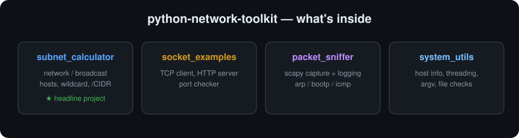

# python-network-toolkit

> A collection of Python networking tools and exercises — built while learning network programming and automation.

   

## About

This repository gathers the Python networking code I wrote while studying how
networks and sockets work. The headline piece is a **subnet calculator** that
does the binary math by hand; around it are working examples of sockets, a
scapy-based packet sniffer, and small system utilities. Every script here has
been fixed to run correctly and organized by topic.

## What's inside



## Repository structure

```
python-network-toolkit/
├── subnet_calculator/
│   └── subnet_calculator.py   # ★ IP + mask → network, broadcast, hosts, wildcard, CIDR
├── socket_examples/
│   ├── tcp_client.py          # Raw HTTP GET over a TCP socket
│   ├── http_server.py         # Minimal HTTP server
│   ├── http_client_test.py    # Test client for the server
│   └── port_check.py          # Check a list of ports on a host
├── http/
│   ├── simple_http_server.py  # Minimal HTTP server
│   ├── custom_http_server.py  # HTTP server with a custom request handler
│   ├── https_server.py        # HTTPS server with TLS
│   ├── http_client.py         # HTTP client
│   ├── data_download.py       # Download a file over HTTP
│   ├── resume_download.py     # Resume an interrupted download
│   └── http_compression.py    # Gzip-compressed HTTP
├── ftp/
│   ├── ftp_upload.py          # Upload a file to an FTP server
│   └── ftp_file_listing.py    # List files on an FTP server
├── email/
│   └── pop3_email_download.py # Download email over POP3
├── packet_sniffer/
│   ├── sniffer.py             # scapy packet capture with logging (needs root)
│   └── raw_socket_sniffer.py  # Packet sniffer using raw sockets (needs root)
├── system_utils/
│   ├── host_info.py           # Hostname, IP, memory usage
│   ├── threading_demo.py      # Running work on multiple threads
│   ├── argv_info.py           # Inspect command-line arguments
│   ├── file_listing.py        # List files in the current directory
│   ├── file_exists_check.py   # Check a file exists and is readable
│   ├── ping_command_builder.py
│   ├── python_version_info.py
│   └── subprocess_demo.py
├── requirements.txt
├── WALKTHROUGH.md
├── LICENSE
└── README.md
```

## Getting started

```bash
pip install -r requirements.txt
```

**Subnet calculator** (the main tool):
```bash
python subnet_calculator/subnet_calculator.py
```
Example:
```
Enter an IP address: 192.168.1.100
Enter a subnet mask: 255.255.255.0

Network address  : 192.168.1.0
Broadcast address: 192.168.1.255
Usable hosts     : 254
Wildcard mask    : 0.0.0.255
Prefix length    : /24
```

The subnet calculation is verified against Python's `ipaddress` module for
/24, /16, /28, and /32 networks.

> **Note:** `packet_sniffer/sniffer.py` needs root privileges and a real network
> interface, so run it on a Linux host rather than in a CI/sandbox environment.

## Skills demonstrated

- IPv4 subnetting and binary math (network/broadcast/wildcard/CIDR)
- Socket programming: TCP clients, a basic HTTP server, port checks
- Packet capture and analysis with scapy and raw sockets
- Application protocols: HTTP/HTTPS servers and clients, FTP, POP3 email
- Python standard library: `socket`, `threading`, `subprocess`, `argparse`, `http`, `ftplib`, `poplib`

## Disclaimer

Provided for **educational purposes only**. Use the networking and capture tools
only on systems and networks you own or are authorized to test. The author
assumes **no liability** for misuse.

## License

Released under the [MIT License](LICENSE).
